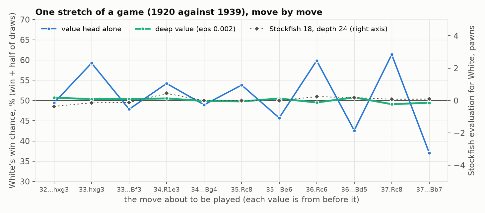
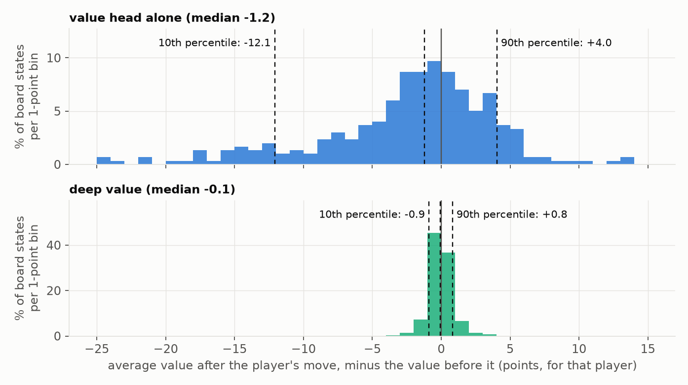
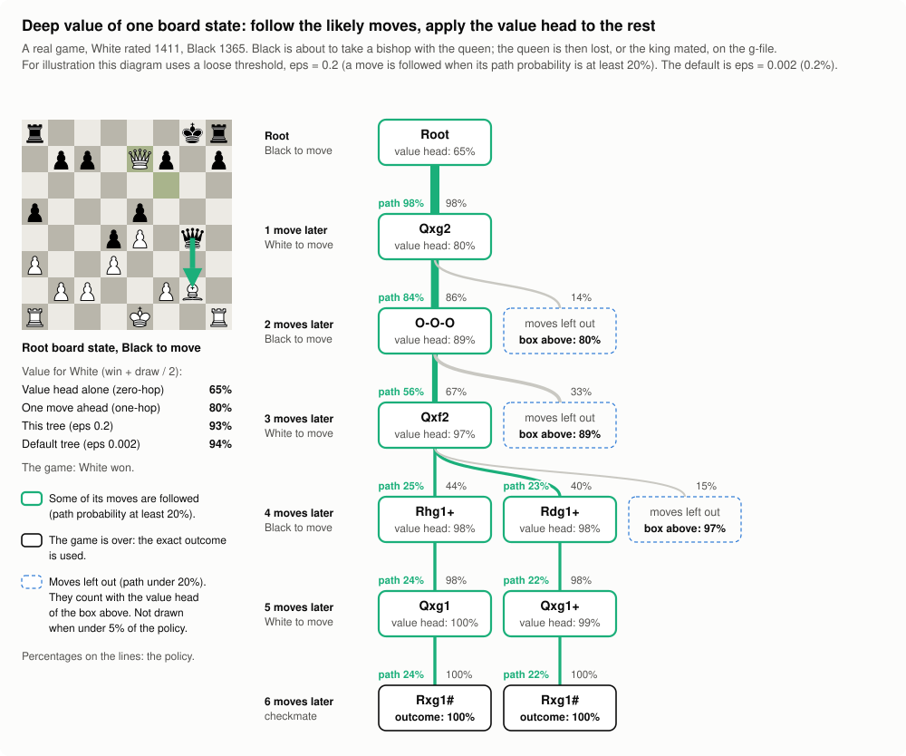

# maia3-deep-value

A value estimate for [Maia-3](https://github.com/CSSLab/maia3) board states that does not zig-zag from move to move.

Maia-3 ([Chessformer, ICLR 2026](https://arxiv.org/abs/2605.19091)) has two output heads: a **policy head** that predicts the move a human of a given rating plays, and a **value head** that predicts the game outcome (win, draw, loss). This repo computes the value in a more stable way.

Contents: [the problem](#the-problem) · [the solution](#the-solution) · [example](#example) · [results](#results) · [the evaluation games](#dataset-evaluation-games) · [the solution in detail](#the-solution-in-detail) · [install](#install) and [use](#use) · [variations explored](#variations-explored) · [limits](#limits)

## The problem

The value head rates the player to move too high. So along a game its value drops when a player moves and climbs back when the opponent moves, whatever the moves are.

## The solution

Instead of asking the value head about the board state itself, play the game forward. The **deep value** follows the policy head for both players through the tree of likely continuations, and estimates the board value by taking a weighted average from the leaf nodes of the traversal.

The **deep value** is much more stable throughout each game and provides a slight improvement in value accuracy.

See [the solution in detail below](#the-solution-in-detail).

## Example

Here is a stretch of a real game: [lichess.org/klZArXVF#63](https://lichess.org/klZArXVF#63). The game is level throughout the stretch: Stockfish 18 at depth 24 rates every one of the eleven board states between −0.36 and +0.44 pawns (the grey diamonds, on the right axis). The other two lines are White's chances as a percentage (win + half of draws), before each move named on the bottom axis.



The blue line is the value head. It says White is ahead whenever White is to move and behind whenever Black is, by up to 24 percentage points from one move to the next, in a position that stays level. A number that falls every time a player makes a reasonable move cannot be shown to a viewer or narrated as it stands.

The green line is the deep value. It stays within a point of 50% through the whole stretch.

This stretch was chosen because it shows the pattern clearly; [Results](#results) below measures how common it is.

## Results

The two factors that change the win probability throughout a game are different board positions and ML model inconsistency

Here we measure ML model inconsistency in isolation by fixing the board position and estimating the board value twice:

1. the value head prediction at the position, and
2. the weighted average of all possible value predictions one move later

A perfect ML model would output the same number in both cases. However, at least for recent Lichess blitz games, Maia-3 seems to be optimistic towards the mover, which often leads it too output lower estimates with #2 than #1.

In contrast, our **deep value** takes a weigthed avreage across multiple layers of possible moves, significantly reducing inconsistency between adjacent board states.

On 299 board states from as many games, in percentage points for the player to move:



| Average after the move, minus the value before it | 10th percentile | Median | 90th percentile | 5 points or more either way | 10 points or more |
| --- | --- | --- | --- | --- | --- |
| Value head alone | −12.1 | −1.2 | +4.0 | 32% of board states | 14% |
| **Deep value** | **−0.9** | **−0.1** | **+0.8** | **0%** | **0%** |

We also tried a few other less successful variations, such as simply taking the average of #1 and #2 above. [Details below](#variations-explored).

## Dataset: evaluation games

We chose much more recent games and measured against maia3-79m. For reference, we also show the Maia-3 paper's set up.

| | This repo | Maia-3 paper (Table 7) |
| --- | --- | --- |
| Source | Lichess rated blitz, October 2026 (after the training period, January 2023 to July 2025) | Lichess blitz, 2022 (the "Allie test set", before the training period) |
| Checkpoint scored | `maia3-79m` | Value metrics are given for the 3M and 5M models only |
| Ratings | 800 to 2399, the same number of games in each 200-point band of the players' average; players within 400 points of each other | Not stated for the test set |
| Games | Between humans, at least 20 moves long (10 by each player), ended on the board or on time | |
| Board states | 5 per game, drawn at random after the first 8 moves (4 by each player) | Positions after "the first 10 moves" of each game |
| Time pressure | Included: 7% of board states have the mover under 30 seconds | Positions after a player first drops under 30 seconds are removed |
| Size | 10,000 board states from 2,000 games | 884,049 positions |

The sample is 2,400 games, 300 per rating band (`evals/data/games.jsonl`). The 2,000 of the main run: 1,509 ended on the board and 491 on time; White won 990, Black 903, and 107 (5.4%) were drawn; the usual time controls are 3+0 (884 games), 5+0 (521), 3+2 (377) and 5+3 (189).

## The solution in detail



### Value computation

The picture is a real game from the evaluation set. Black (rated 1365) is about to take a bishop with the queen, the move almost every player at that rating plays. It loses: White castles, and whichever rook then checks on the g-file wins the queen or mates. White won the game.

Every box in the picture shows what the value head says about that board state on its own. The deep value uses the exact outcome where a game ends (black boxes) and the value head only for the moves that are not followed (dashed boxes), then averages back up to the root.

All three estimates are built from the same two model outputs. For a board state $s$, write $v(s)$ for the value head's output and $\pi(a \mid s)$ for the policy head's probability of move $a$. Values below are for White, as one number (win + draw / 2).

**Value head alone (zero-hop).** One model evaluation, the "value head" number in the root box:

```math
V_0(s) = v(s) = 0.65
```

**One move ahead (one-hop).** The value head on each board state one move later, weighted by the policy. Here one move, Qxg2, has 98% of the policy, and the value head after it says 0.80:

```math
V_1(s) = \sum_a \pi(a \mid s)\, v(s \cdot a) = 0.80
```

**Deep value.** The same average, applied again and again, but only over the moves likely enough to matter. At a board state $n$ reached with path probability $q$, the moves followed are those with $q\,\pi(a \mid n) \ge \varepsilon$; call them $F$. The rest of the policy's weight counts with the value head of $n$ itself, and a finished game has its exact outcome:

```math
D(n, q) =
\begin{cases}
\text{outcome}(n) & \text{if the game is over at } n \\[4pt]
\displaystyle\sum_{a \in F} \pi(a \mid n)\, D\big(n \cdot a,\; q\,\pi(a \mid n)\big) \;+\; \Big(1 - \sum_{a \in F} \pi(a \mid n)\Big)\, v(n) & \text{otherwise}
\end{cases}
\qquad V(s) = D(s, 1)
```

When no move is likely enough ($F$ is empty) this is just $v(n)$: the board state is a leaf.

Here's the computation of the **deep value** for the example above:

| Board state | Path probability | Deep value |
| --- | --- | --- |
| Rxg1# (both lines) | 0.24 and 0.22 | checkmate: 1.00 |
| Qxg1 and Qxg1+ | 0.24 and 0.22 | 1.00 × 1.00 = 1.00 |
| Rhg1+ and Rdg1+ | 0.25 and 0.23 | 0.98 × 1.00 + 0.02 × 0.98 = 1.00 |
| Qxf2 | 0.56 | 0.445 × 1.00 + 0.404 × 1.00 + 0.151 × 0.97 = 1.00 |
| O-O-O | 0.84 | 0.67 × 1.00 + 0.33 × 0.89 = 0.96 |
| Qxg2 | 0.98 | 0.86 × 0.96 + 0.14 × 0.80 = 0.94 |
| Root | 1.00 | 0.98 × 0.94 + 0.02 × 0.65 = **0.93** |

### The algorithm

1. Start at the root board state with path probability 1.
2. At each board state, follow every move whose path probability (the board state's own, times the policy's probability of the move) is at least `eps`. The default is 0.002, and it is the only parameter.
3. The moves not followed keep their policy weight and count with the value head of the board state they leave. A board state with no move to follow is a leaf, valued by its value head. Checkmate and draws get their exact outcome.
4. Average back up: a board state's value is the policy-weighted average of the moves followed, plus the left-out weight times its own value head.

```
value(node, path_prob):
    if game over at node:  return exact outcome
    total, followed = 0, 0
    for move m with path_prob * policy(m) >= eps:
        total    += policy(m) * value(node after m, path_prob * policy(m))
        followed += policy(m)
    return total + (1 - followed) * value_head(node)
```

Five properties are worth knowing.

- **Why it does not zig-zag.** The value head leans towards whoever is to move. An average at one fixed depth has every line end with the same player to move, so it keeps the lean at any depth. A tree cut by path probability ends its lines at different depths, some with one player to move and some with the other, and the likely explanation of the results above is that the leans then largely cancel.
- **Nobody maximises.** This is the value of the model's own policy (policy evaluation in the reinforcement-learning sense), not a search for the best move. It answers "what happens if both sides keep playing like players of these ratings", which is the question the value head was trained on.
- **The tree's width is bounded, its depth is not.** Every board state in the tree has path probability at least `eps`, and the board states at any one depth are disjoint events, so there are at most 1/`eps` of them per depth. Where one move takes the whole policy (recaptures, forced mates, simple endgames) a line runs deep at almost no cost; where the policy is spread wide the tree stays shallow. At the default threshold a tree averages about 390 model evaluations and its deepest line 12 moves.
- **Weights are the policy's own.** The moves followed are not renormalised, so nothing is assumed about the moves left out except that they are worth what the value head says the board state is worth.
- **Looser thresholds come free.** Path probability only falls along a line, so the tree for a larger `eps` is the top of the tree for a smaller one. One traversal gives the deep value at every looser threshold, and zero-hop and one-hop with it (`also=` in the API).

The tree is grown breadth first, one level per batch through the model, and evaluations are cached by move history, so consecutive board states of one game share most of their work.

### Terms

The names follow the Maia-3 paper where it has them.

| Term | Meaning |
| --- | --- |
| Move | One player's turn, as in the Maia-3 paper (a "ply" to chess programmers). "Two moves ahead" is one move by each player. Move numbers in a game score, such as 33.hxg3, count a move by each player as usual. The data files and the command line call the number of moves played so far the `ply`. |
| Board state | A position together with the moves that led to it. Maia-3 reads the last 8 board states, so history is part of the input. |
| Policy | The policy head's probability for each legal move, at the mover's rating. |
| Value | The game outcome prediction: probabilities of win, draw and loss. As one number: win + draw / 2, usually written as a percentage. A point is one percentage point of that. |
| Zero-hop | The value head applied to the board state itself. One model evaluation. |
| One-hop | The value head applied to each board state one move later, averaged with the policy as weights. |
| Deep value | This repo: the same average carried down a tree of the moves whose path probability is at least `eps`. |
| Path probability | The product of the policy probabilities of the moves from the root to a node: the share of games from the root that reach it, if both sides play like the policy. |

## Install

```
pip install "maia3-deep-value[maia] @ git+https://github.com/quarup/maia3-deep-value"
```

or from a checkout, `pip install -e ".[maia,evals,dev]"`. The `maia` extra brings Maia-3 itself, `torch` and the Hugging Face client; the weights download on first use. Python 3.10 or later. It runs on a laptop CPU: the 79M model does about 125 board states a second on an Apple M-series CPU and about 215 on its GPU (`device="mps"`).

## Use

```python
import chess
from deep_value import DeepValue, Maia

board = chess.Board()
for san in ["e4", "e5", "Nf3", "Nc6", "Bc4", "Nf6", "Ng5", "Bc5"]:    # keep the move stack: it is model input
    board.push_san(san)

deep = DeepValue(Maia("maia3-79m"), eps=0.002)          # eps is the only parameter
v = deep.value(board, white_elo=1500, black_elo=1480)

v.wdl        # (win, draw, loss) for White: the deep value
v.value      # the same as one number: win + draw / 2
v.zero_hop   # the value head alone
v.one_hop    # one move ahead
v.moves      # the likeliest moves here, each with its policy probability and the deep value after it
v.nodes, v.depth
```

`deep.value_many([(board, white_elo, black_elo), ...])` evaluates several board states in shared batches, `also=[(0.01, 40), (0.05, 40)]` adds looser thresholds from the same tree, and `deep.explain(...)` returns the whole tree.

From the command line, for every board state of a game:

```
$ deep-value examples/game.pgn --plies 52,53,54,55,56
ply  52 27.Rf1    win 0.039 draw 0.079 loss 0.882 (White) | deep 0.078  one-hop 0.120  zero-hop 0.138 | depth  9  nodes   243
ply  53 27...Qf5  win 0.035 draw 0.041 loss 0.924 (White) | deep 0.056  one-hop 0.057  zero-hop 0.140 | depth  8  nodes   164
ply  54 28.Rxf5   win 0.282 draw 0.174 loss 0.544 (White) | deep 0.369  one-hop 0.415  zero-hop 0.524 | depth 17  nodes   361
ply  55 28...Rf8  win 0.294 draw 0.177 loss 0.529 (White) | deep 0.383  one-hop 0.550  zero-hop 0.431 | depth 16  nodes   362
ply  56 29.Rxf8#  win 0.875 draw 0.053 loss 0.072 (White) | deep 0.901  one-hop 0.881  zero-hop 0.908 | depth  9  nodes    97
```

`--ratings 2000` evaluates the same game as two 2000-rated players would continue it, `--eps` sets the threshold, and `-o out.json` writes everything (and resumes a stopped run).

The tree in `deep_value/tree.py` does not import Maia-3. Any function `evaluate(boards, self_elos, oppo_elos)` that returns a policy and a win, draw, loss triple per board can stand in for it, which is how the tests run without a model.

## Variations explored

Simpler alternatives were tried first. Each one either keeps the zig-zag or costs more for the same stability. The data behind every line is in [docs/design-notes.md](docs/design-notes.md) and [docs/experiment-log.md](docs/experiment-log.md).

Stability is measured by following 60 games move by move (4,425 board states) and looking at how the value changes from one move to the next:

- **Change per move:** the standard deviation of the change in value over one played move, in points. Some of it is real, because moves matter; the rest is the zig-zag.
- **Correlation of successive changes:** −0.6 means a drop is usually followed by a rise, which is the zig-zag. Zero means no pattern.

| Estimate | Model evaluations | Change per move (points) | Correlation of successive changes |
| --- | --- | --- | --- |
| Value head alone | 1 | 7.5 | −0.61 |
| One move ahead | about 32 | 7.3 | −0.62 |
| Midpoint of the two rows above | about 32 | 4.7 | 0.00 |
| Deep value, `eps` 0.5 | 2 | 5.9 | −0.21 |
| Deep value, `eps` 0.2 | 4 | 5.2 | −0.06 |
| Deep value, `eps` 0.1 | 8 | 5.0 | −0.03 |
| Deep value, `eps` 0.05 | 16 | 4.9 | −0.04 |
| Deep value, `eps` 0.01 | 80 | 4.8 | −0.05 |
| Deep value, `eps` 0.002 (default) | 390 | 4.7 | −0.05 |

### Simpler estimates

- **One move ahead** does not help. It moves the lean to the other player and zig-zags as much.
- **A fixed depth of 2 to 8 moves** keeps the lean at every depth ([docs/consistency.md](docs/consistency.md)), and the cost grows about thirtyfold per move of depth.
- **The midpoint of the value head and one move ahead** cancels the lean and is as stable as the default deep value. It costs about 32 evaluations, though, and a tree of 4 evaluations (`eps` 0.2) is nearly as stable. It is also slightly less accurate against real game results than any tree from `eps` 0.2 down.

### The threshold

- **A small tree already removes most of the zig-zag.** At `eps` 0.2, four model evaluations, the correlation is close to zero. Use a loose threshold when cost matters.
- **Finer than the default changes little.** On 500 board states valued down to `eps` 0.0005 (1,550 evaluations each), the default's value is 0.35 points from the finest tree's on average.

One tree at `eps` 0.002 answers every looser threshold, so trying several costs nothing extra.

### Which moves to follow

The first version followed the likeliest moves at each board state up to 97% of the policy, at most 8 of them, with weights renormalised. The present rule is as accurate against real game results, with fewer evaluations (389 against 501) and two fewer settings.

### What the moves left out are worth

A move that is not followed counts with the value head of the board state it leaves. Measured directly, such moves are worth 6 to 16 points less than that, more the rarer the move. Three corrections were tried, and none brought the result closer to a much larger tree. The likely reason is the lean again: the value head at a leaf leans towards the opponent of the player whose moves were left out, which already offsets the optimism.

## Limits

- **Cost.** A deep value at the default threshold averages about 390 model evaluations, 2 to 4 seconds on a laptop CPU, against one evaluation for the value head. A whole game takes a few minutes (the 57-move example above: three and a half minutes on a busy laptop CPU). A looser threshold cuts this ([the threshold](#the-threshold)).
- **It inherits the policy's blind spots.** If the policy head gives a move too little probability, the lines behind that move are underweighted. The tree corrects the value head with the policy head; it adds no outside chess knowledge and no engine.
- **No clock.** The released Maia-3 checkpoints take no clock input, so time trouble is invisible to both heads and to the tree. In games that ended on time the deep value is no closer to the outcome than the value head (MSE change x1000: −0.2, interval −2.9 to +2.6).
- **Moves left out are valued roughly.** Rare blunders and rare brilliancies below the threshold stay invisible ([what the moves left out are worth](#what-the-moves-left-out-are-worth)).
- **One-hop is slightly approximate.** The `one_hop` reported with a tree covers the root's moves that are in the tree; the rest (about 0.6% of the policy at the default threshold) count with the root's value head.
- **History matters.** Give boards with their move stack. A bare FEN works, but the model then sees a padded history it was not trained on.
- **One checkpoint, one kind of game.** Everything here is `maia3-79m` on Lichess blitz.

## Rerunning the evals

The sampled games and every per-board-state result are in `evals/data/` and `evals/results/`, so the reports can be rebuilt without rerunning the model.

```
python evals/fetch_games.py --month 2026-10 --per-bin 300      # sample games from the Lichess database
python evals/run_eval.py main --games 2000 --eps 0.002         # accuracy; about 5 hours on a laptop GPU
python evals/run_eval.py sweep --games 100 --eps 0.0005
python evals/report.py                                         # writes docs/evals.md and its charts
python evals/lookahead.py --positions 300 --device mps         # k moves ahead; about 90 minutes
python evals/tail_deep.py --positions 300 --device mps         # every legal move valued afresh
python evals/run_games.py games --games 60 --eps 0.002         # every board state of 60 games; about 2 hours
python evals/example_stockfish.py                              # optional: Stockfish on the example stretch
python evals/consistency.py                                    # writes docs/consistency.md and its charts
```

| Document | What is in it |
| --- | --- |
| [docs/consistency.md](docs/consistency.md) | The zig-zag measurements in full (generated) |
| [docs/evals.md](docs/evals.md) | Accuracy against real outcomes in full: slices, calibration, thresholds (generated) |
| [docs/design-notes.md](docs/design-notes.md) | Why the algorithm is built this way, with the comparison behind each choice |
| [docs/experiment-log.md](docs/experiment-log.md) | How the consistency measures were arrived at, including the ones dropped |

## Licence

The code in this repo is MIT. It depends on the [`maia3`](https://github.com/CSSLab/maia3) package, which is AGPL-3, so running it with Maia-3 is subject to that licence. The evaluation games come from the [Lichess open database](https://database.lichess.org/) (CC0).

Maia-3 is the work of the CSSLab at the University of Toronto: *Chessformer: A Unified Architecture for Chess Modeling*, ICLR 2026.
