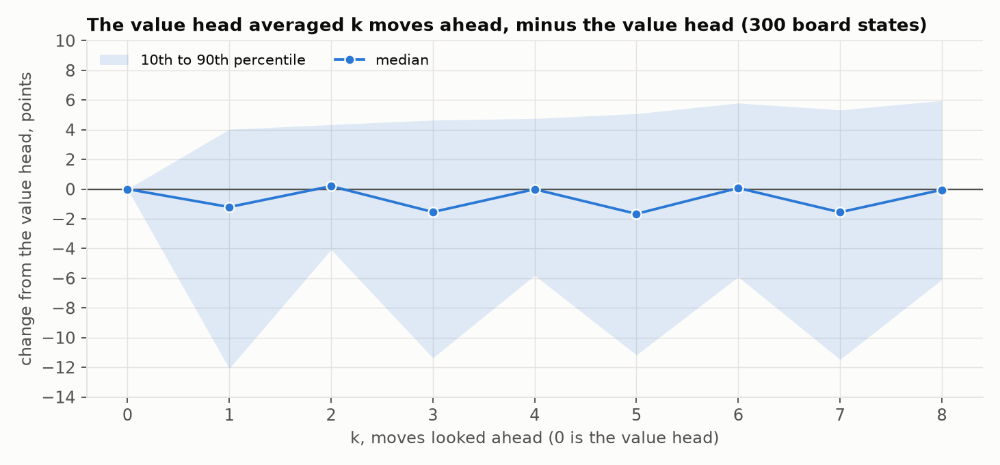
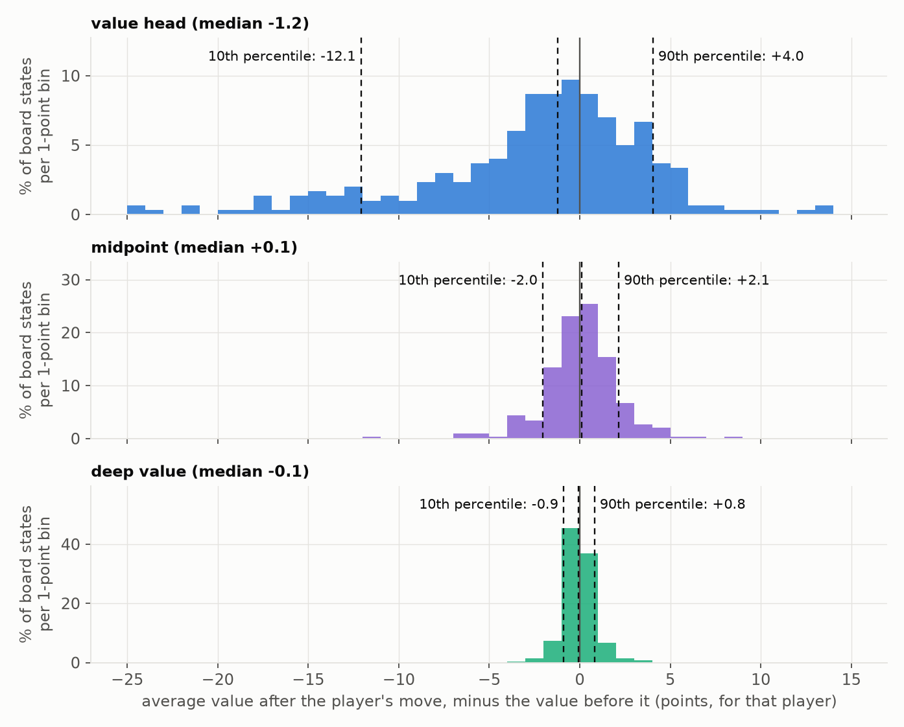
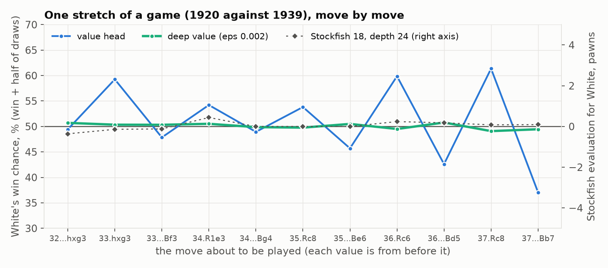
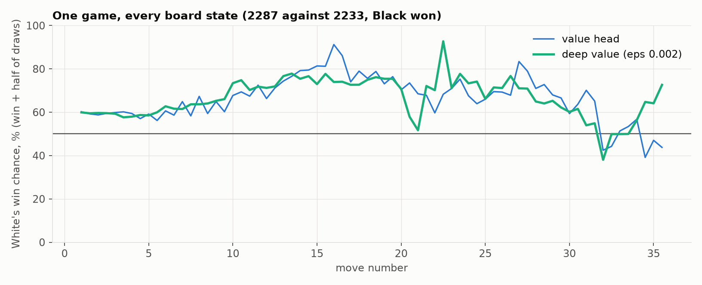

# Self-consistency

Generated by `evals/consistency.py`; rerun it rather than editing here. The fit to real outcomes is in
[evals.md](evals.md), and how these measures were arrived at is in [experiment-log.md](experiment-log.md).

A value is a forecast of the result. A sound forecast, before a move, equals the average of what it will say
after the move, over the moves the player might make. Things that follow, each measurable without knowing who
won:

- **Looking further ahead should not change the answer on average.** The value head on a board state, and the
  value head averaged over the board states k moves later, are forecasts of the same result.
- **No drift.** A move should not change the mover's value on average.
- **No zig-zag.** One change should not predict the next. A correlation of -1 between successive changes means
  every drop is taken back on the next move.
- **No contradiction.** The value before a move should lie between the values after the best and the worst
  move.
- **No excess movement.** Over a game, the squared changes should add up to the squared distance from the first
  value to the result. A ratio above 1 means the estimate moves more than the information it gains.

The deep value is built as an average over its moves, so it should do well here. The checks are still not
circular: the value after a move comes from a separate tree with its own budget, which reaches board states
the first tree never saw.

## The value head averaged k moves ahead: 300 board states

`evals/lookahead.py`. V_k is the value head k moves later, weighted by the policy along every line; k = 0 is the value head and k = 1 is one move ahead. k = 0, 1, 2 are exact. k = 3 and up are sampled: 500 lines per board state, each move drawn from the policy, which is unbiased; the noise on one step averages 0.8 points, and the same draws give k = 2 within 0.02 points of the exact value on average. Points, for the player to move at the sampled board state; ± is a 95% interval.

| k moves ahead | Minus the value head (k = 0): 10th percentile | Median | 90th | Average | Step from k − 1: 10th percentile | Median | 90th | Average | Average minus the deep value (eps 0.002) |
| --- | --- | --- | --- | --- | --- | --- | --- | --- | --- |
| 0 |  |  |  |  |  |  |  |  | +1.26 ± 0.66 |
| 1 | -12.1 | -1.2 | +4.0 | -2.44 ± 0.73 | -12.1 | -1.2 | +4.0 | -2.44 ± 0.73 | -1.17 ± 0.57 |
| 2 | -4.1 | +0.2 | +4.3 | +0.10 ± 0.47 | -2.7 | +1.5 | +10.8 | +2.54 ± 0.64 | +1.37 ± 0.45 |
| 3 | -11.4 | -1.5 | +4.6 | -2.70 ± 0.81 | -9.8 | -1.4 | +2.3 | -2.81 ± 0.62 | -1.44 ± 0.44 |
| 4 | -5.8 | -0.0 | +4.8 | -0.10 ± 0.60 | -2.1 | +1.3 | +9.5 | +2.60 ± 0.59 | +1.17 ± 0.39 |
| 5 | -11.2 | -1.7 | +5.1 | -2.66 ± 0.82 | -9.0 | -1.2 | +1.9 | -2.56 ± 0.57 | -1.40 ± 0.38 |
| 6 | -5.9 | +0.1 | +5.8 | +0.02 ± 0.64 | -1.7 | +1.2 | +8.8 | +2.69 ± 0.59 | +1.29 ± 0.32 |
| 7 | -11.5 | -1.6 | +5.3 | -2.70 ± 0.83 | -9.1 | -1.2 | +1.5 | -2.72 ± 0.55 | -1.43 ± 0.32 |
| 8 | -6.1 | -0.0 | +6.0 | +0.01 ± 0.66 | -1.4 | +1.1 | +8.6 | +2.71 ± 0.54 | +1.27 ± 0.31 |

The deep value's own step from k = 0 to 1 (its value against the average of its moves' deep values, each from a tree of its own, eps 0.01): 10th percentile -0.9, median -0.1, 90th +0.8.

### Where the lean is

Per board state: the average of V_k over odd k minus the average over even k, points. Moves are counted for both players together. The model does not see the clock; it is shown because it goes with the stage of the game.

| Board states | Number | 10th percentile | Median | 90th | Average |
| --- | --- | --- | --- | --- | --- |
| All | 300 | -9.2 | -1.2 | +1.8 | -2.63 |
| First 20 moves of the game | 81 | -1.6 | +0.1 | +1.9 | -0.02 |
| Moves 21 to 40 | 99 | -3.0 | -0.4 | +2.6 | -0.39 |
| Moves 41 to 70 | 85 | -8.8 | -3.3 | -0.1 | -4.02 |
| After move 70 | 35 | -18.5 | -11.3 | -4.1 | -11.66 |
| Mover has 2 minutes or more | 206 | -3.7 | -0.4 | +2.0 | -0.83 |
| 1 to 2 minutes | 51 | -10.2 | -2.6 | +0.8 | -3.86 |
| 30 to 60 seconds | 16 | -13.8 | -8.7 | -2.8 | -8.40 |
| Under 30 seconds | 27 | -20.6 | -9.4 | -2.9 | -10.63 |

### How large the swing is, board state by board state

Absolute values, points.

| Step | Median | 80th percentile | 90th | 95th | Mean |
| --- | --- | --- | --- | --- | --- |
| k = 0 to 1 | 3.1 | 7.3 | 12.4 | 15.2 | 4.8 |
| k = 1 to 2 | 2.4 | 5.7 | 10.8 | 13.7 | 4.1 |
| k = 2 to 3 | 2.3 | 6.2 | 9.8 | 13.7 | 4.0 |
| k = 3 to 4 | 2.0 | 5.4 | 9.5 | 13.4 | 3.7 |
| k = 4 to 5 | 1.9 | 5.6 | 9.0 | 13.4 | 3.5 |
| k = 5 to 6 | 1.8 | 5.2 | 8.8 | 13.8 | 3.5 |
| k = 6 to 7 | 1.7 | 5.3 | 9.1 | 12.4 | 3.5 |
| k = 7 to 8 | 1.8 | 5.2 | 8.6 | 13.1 | 3.4 |
| Highest minus lowest over all k | 6.2 | 12.5 | 16.3 | 21.5 | 8.3 |
| Deep value (eps 0.01): own value to the average of its moves' deep values (299 board states) | 0.4 | 0.9 | 1.3 | 1.8 | 0.6 |

### Gap to the deep value (eps 0.002)

Absolute values, points.

| Estimate | Median | 80th percentile | 90th | 95th | Mean |
| --- | --- | --- | --- | --- | --- |
| 0 moves ahead | 2.7 | 6.7 | 9.5 | 11.7 | 4.1 |
| 1 moves ahead | 2.1 | 4.9 | 7.9 | 11.5 | 3.3 |
| 2 moves ahead | 1.8 | 4.1 | 5.9 | 8.5 | 2.8 |
| 3 moves ahead | 1.4 | 3.4 | 5.6 | 8.2 | 2.5 |
| 4 moves ahead | 1.4 | 3.2 | 5.1 | 6.6 | 2.2 |
| 5 moves ahead | 1.2 | 3.5 | 4.5 | 8.0 | 2.2 |
| 6 moves ahead | 1.1 | 3.0 | 4.8 | 6.3 | 2.0 |
| 7 moves ahead | 1.3 | 3.3 | 5.3 | 7.6 | 2.1 |
| 8 moves ahead | 1.2 | 3.1 | 4.6 | 6.4 | 2.0 |
| Midpoint | 1.8 | 4.7 | 7.3 | 8.8 | 2.9 |
| Deep value, eps 0.2 | 1.8 | 4.1 | 5.7 | 7.6 | 2.6 |
| Deep value, eps 0.05 | 1.0 | 2.2 | 3.5 | 4.4 | 1.5 |
| Deep value, eps 0.01 | 0.4 | 1.1 | 1.6 | 2.0 | 0.7 |

## One move: 299 board states, every legal move valued afresh

Each legal move gets its own tree (`evals/tail_deep.py`), so the deep value of a board state is compared with deep values it was not built from. If every legal move lowers the value, the value before the move was one the player could not keep. Points, for the player to move; ± is a 95% interval. The midpoint is the average of the value head and one move ahead; its step is exact, from the values two moves ahead (`evals/lookahead.py`).

| Estimate | Value after the move, averaged over the moves, minus the value before: 10th percentile | Median | 90th | Average (should be 0) | Mean absolute | 5 points or more either way | 10 points or more | Every move lowers the value | Every move lowers it by over 2 points |
| --- | --- | --- | --- | --- | --- | --- | --- | --- | --- |
| Value head | -12.1 | -1.2 | +4.0 | -2.45 ± 0.73 | 4.77 | 31.8% | 14.0% | 35.1% | 22.7% |
| Midpoint | -2.0 | +0.1 | +2.1 | +0.04 ± 0.24 | 1.44 | 3.3% | 0.3% |  |  |
| Deep value (eps 0.01) | -0.9 | -0.1 | +0.8 | -0.04 ± 0.09 | 0.58 | 0.0% | 0.0% | 3.0% | 0.0% |

## Along the game: 60 games, 4425 board states

Every board state of each game, valued at the players' ratings (`evals/run_games.py`); a change is the value after the move that was played minus the value before it. Points; 95% intervals resample games.

| Estimate | A move changes the mover's value by (should be 0) | Mean absolute change per move | Correlation of one change with the next (should be 0) | Squared changes over the game / squared distance start to result (should be 1) |
| --- | --- | --- | --- | --- |
| Value head | -2.38 (-3.09 to -1.61) | 5.49 (4.93 to 6.16) | -0.61 (-0.70 to -0.50) | 2.16 (1.62 to 2.89) |
| One move ahead | +3.07 (+2.35 to +3.86) | 5.48 (4.93 to 6.10) | -0.62 (-0.70 to -0.52) | 2.17 (1.62 to 2.83) |
| Deep value, eps 0.05 | +0.21 (+0.04 to +0.39) | 2.63 (2.48 to 2.81) | -0.04 (-0.09 to +0.02) | 0.89 (0.73 to 1.07) |
| Deep value, eps 0.01 | +0.50 (+0.35 to +0.66) | 2.63 (2.48 to 2.81) | -0.05 (-0.11 to +0.01) | 0.89 (0.73 to 1.07) |
| Deep value, eps 0.002 | +0.53 (+0.36 to +0.71) | 2.58 (2.41 to 2.75) | -0.05 (-0.11 to +0.01) | 0.86 (0.71 to 1.04) |

### How large the change from one move to the next is

Absolute change in the value over one played move, points, all moves of all games.

| Estimate | Median | 80th percentile | 90th | 95th | 5 points or more | 10 points or more |
| --- | --- | --- | --- | --- | --- | --- |
| Value head | 3.7 | 8.7 | 12.6 | 17.0 | 38.8% | 16.0% |
| One move ahead | 3.7 | 9.0 | 12.8 | 16.9 | 39.8% | 16.6% |
| Deep value, eps 0.002 | 1.2 | 3.8 | 6.3 | 9.5 | 14.5% | 4.4% |
| Value head's change minus the deep value's, same move | 3.5 | 8.4 | 12.0 | 16.0 | 37.5% | 14.7% |

## Accuracy and movement side by side

MSE of value on the 10000 board states of the main run; an improvement is the other estimate's MSE minus this one's, times 1,000, with a 95% interval from resampling games. The last four columns are from the 60 whole games: standard deviations in points, pooled over games, and the correlation of one change with the next. The spread of values over a game is dominated by the real course of the game, so it does not separate the estimates; the change per move does.

| Estimate | Model evaluations | MSE of value | Improvement over the value head | Improvement over the midpoint | Spread of values over a game | Change per move | Gap to the average of the two neighbouring board states | Correlation of successive changes |
| --- | --- | --- | --- | --- | --- | --- | --- | --- |
| Value head | 1 | 0.1949 |  | -1.7 (-2.3 to -1.2) | 15.3 | 7.5 | 6.5 | -0.61 |
| One move ahead | about 32 | 0.1937 | 1.3 (0.2 to 2.3) | -0.4 (-1.0 to 0.1) | 15.2 | 7.3 | 6.4 | -0.62 |
| Midpoint | about 32 | 0.1932 | 1.7 (1.2 to 2.3) |  | 15.0 | 4.7 | 3.4 | +0.00 |
| Deep value, eps 0.5 | 2 | 0.1934 | 1.6 (0.9 to 2.3) | -0.1 (-0.7 to 0.4) | 15.2 | 5.9 | 4.6 | -0.21 |
| Deep value, eps 0.2 | 4 | 0.1922 | 2.7 (1.8 to 3.7) | 1.0 (0.4 to 1.7) | 15.3 | 5.2 | 3.8 | -0.06 |
| Deep value, eps 0.1 | 8 | 0.1920 | 3.0 (2.0 to 4.0) | 1.3 (0.6 to 2.0) | 15.2 | 5.0 | 3.6 | -0.03 |
| Deep value, eps 0.05 | 16 | 0.1916 | 3.3 (2.3 to 4.4) | 1.6 (0.9 to 2.4) | 15.2 | 4.9 | 3.5 | -0.04 |
| Deep value, eps 0.01 | 80 | 0.1913 | 3.6 (2.6 to 4.7) | 1.9 (1.1 to 2.7) | 15.1 | 4.8 | 3.5 | -0.05 |
| Deep value, eps 0.002 | 390 | 0.1911 | 3.9 (2.7 to 5.0) | 2.1 (1.3 to 3.0) | 15.0 | 4.7 | 3.4 | -0.05 |

## Two games

A stretch chosen to show the pattern clearly: a level middlegame (Stockfish 18 at depth 24 rates all eleven board states between -0.36 and +0.44 pawns) where the value head reverses direction on every move. White's value, points.

| To move | Value head | Deep value | Move then played |
| --- | --- | --- | --- |
| Black | 49 | 51 | 32...hxg3 |
| White | 59 | 50 | 33.hxg3 |
| Black | 48 | 50 | 33...Bf3 |
| White | 54 | 51 | 34.R1e3 |
| Black | 49 | 50 | 34...Bg4 |
| White | 54 | 50 | 35.Rc8 |
| Black | 46 | 50 | 35...Be6 |
| White | 60 | 50 | 36.Rc6 |
| Black | 43 | 51 | 36...Bd5 |
| White | 61 | 49 | 37.Rc8 |
| Black | 37 | 49 | 37...Bb7 |

And a whole game chosen by rule, not by eye: of the games of 50 to 90 moves, the one whose value-head movement per move is the median.

