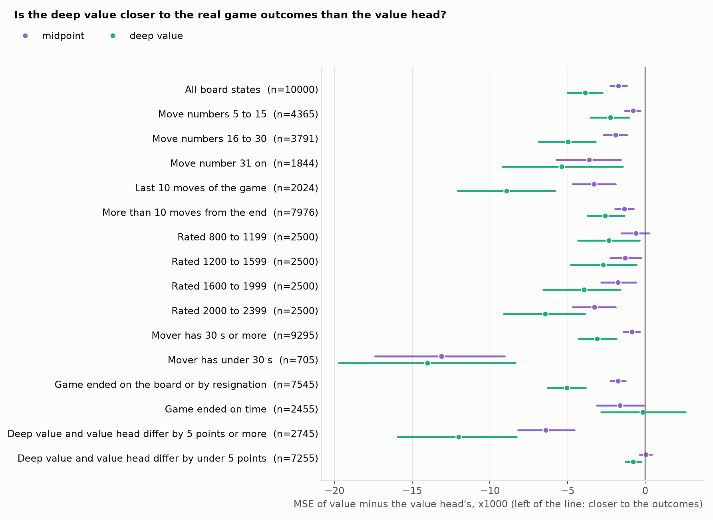
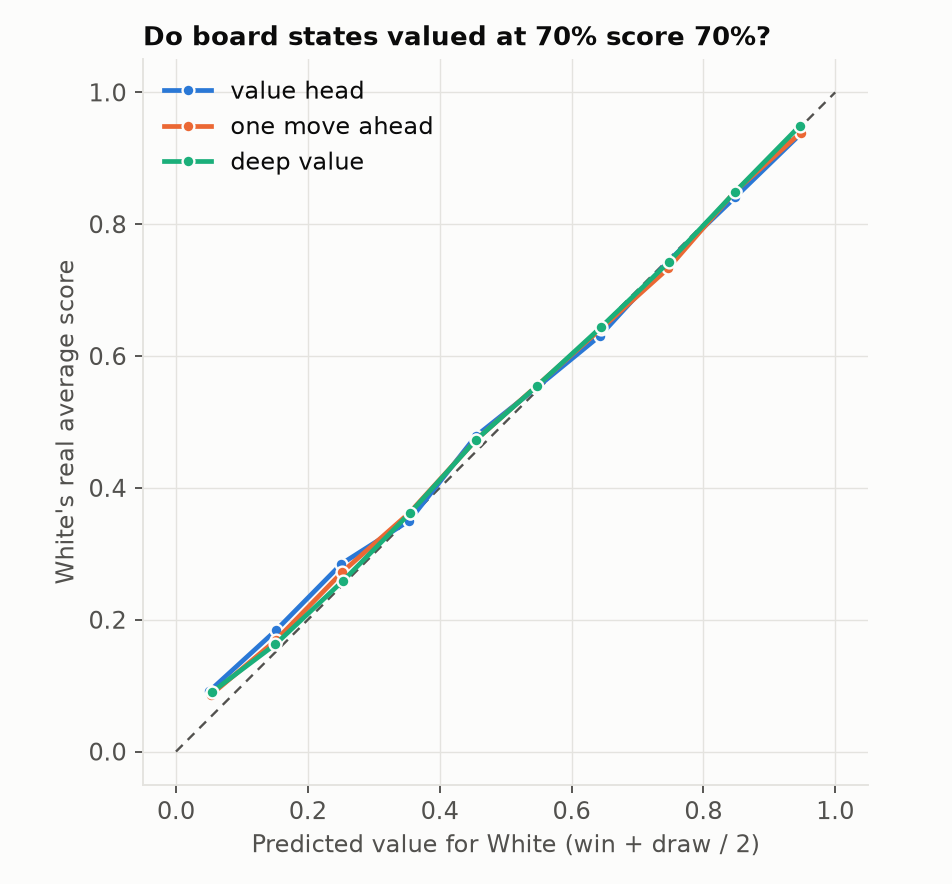
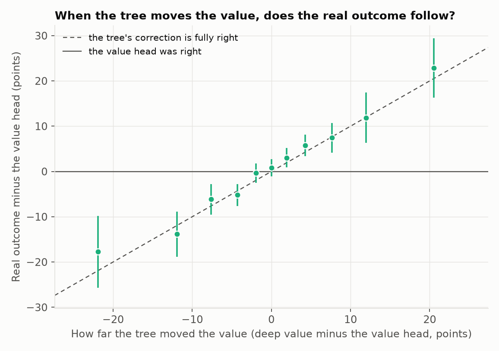
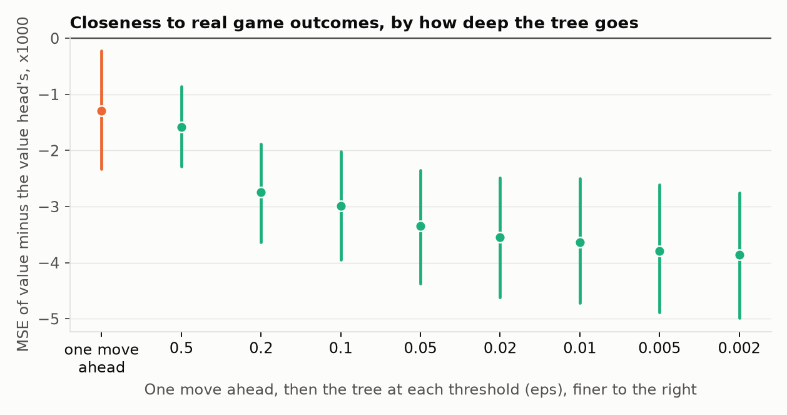
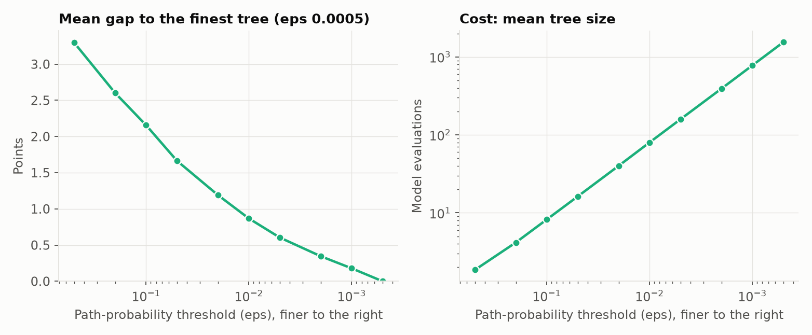

# Evals

This page is written by `evals/report.py` from the stored results; rerun it rather than editing here. The
short version is in the [README](../README.md#results), and the reasons behind the algorithm's design are in
[design-notes.md](design-notes.md). How consistent each estimate is with itself from move to move is on its
own page, [consistency.md](consistency.md).

## Method

- **Games.** Rated blitz games from the [Lichess open database](https://database.lichess.org/), October 2026,
  which is after the period Maia-3 was trained on. Games between humans that ended on the board, by
  resignation or on time, at least 20 moves long (a move is one player's turn, so 10 by each), with the players within 400 rating points of each other.
  300 games were sampled per 200-point rating band from 800 to 2399 (`evals/fetch_games.py`); the runs take
  the bands in turn, so any prefix of the games is balanced by rating. How this population differs from the
  Maia-3 paper's test set is in the [README](../README.md#dataset-evaluation-games).
- **Board states.** Five per game, drawn at random after the first 8 moves, with a seed fixed by the game id.
- **Estimates.** For each board state, at the two players' real ratings: the value head (`zero_hop` in the
  data), one move ahead (the value head averaged over the board states one move later, weighted by the policy;
  `one_hop` in the data), the midpoint (the average of those two), and the deep value. One tree gives all of them, and
  the deep value at every looser threshold and at several depth caps as well.
- **Truth.** How the game ended: 1, 1/2 or 0 for White.
- **Metrics.** Value accuracy (the Maia-3 paper's "game outcome prediction accuracy": how often the likeliest
  of win, draw, loss is what happened), value loss (the cross-entropy the value head is trained on), the
  Brier score over the three outcomes, and the MSE of value (the squared gap between win + draw / 2 and the
  result). Higher accuracy is better; lower is better for the other three.
- **Intervals.** Board states of one game share its result, so 95% intervals come from resampling whole
  games (2,000 resamples), on the paired difference from the value head.
- **Raw data.** `evals/data/games.jsonl` holds the games and `evals/results/<run>/*.jsonl` one row per board
  state with every estimate's full (win, draw, loss), so any other metric can be computed without the model.

## Main run

10000 board states from 2000 games; tree threshold (eps) 0.002; mean tree size 390 board states, mean deepest line 12.2 moves.

| Value estimate | Value accuracy | vs value head, points (95%) | Value loss (cross-entropy) | vs value head, x1000 (95%) | Brier score (3 outcomes) | vs value head, x1000 (95%) | MSE of value | vs value head, x1000 (95%) |
| --- | --- | --- | --- | --- | --- | --- | --- | --- |
| value head | 63.2% |  | 0.7360 |  | 0.4564 |  | 0.1949 |  |
| one move ahead | 63.6% | +0.4 (-0.2 to +0.9) | 0.7328 | -3.2 (-8.0 to +1.6) | 0.4541 | -2.3 (-4.6 to +0.2) | 0.1937 | -1.3 (-2.4 to -0.2) |
| midpoint | 63.6% | +0.4 (-0.1 to +0.8) | 0.7276 | -8.4 (-11.3 to -5.8) | 0.4528 | -3.6 (-4.7 to -2.4) | 0.1932 | -1.7 (-2.3 to -1.2) |
| deep value | 64.0% | +0.8 (+0.2 to +1.3) | 0.7243 | -11.7 (-15.9 to -7.5) | 0.4489 | -7.5 (-9.9 to -5.1) | 0.1911 | -3.9 (-5.0 to -2.7) |

### The games, and the Maia-3 paper's filters

How the 2000 games ended: 1509 Normal, 491 Time forfeit; results: 990 1-0, 903 0-1, 107 1/2-1/2; time controls (seconds + increment): 884 180+0, 521 300+0, 377 180+2, 189 300+3. 7% of the board states have the mover under 30 seconds and 25% are within the first 20 moves.

The paper scores the value head on positions after "the first 10 moves" (read here as 10 by each player) and before either player first drops under 30 seconds. The same two filters keep 6331 of these board states. The other differences from the paper's test set (the checkpoint, the year, the rating mix, the number of positions per game) remain, so the rows below are not a reproduction of its numbers.

| Value estimate | Value accuracy, all | with the filters | Value loss, all | with the filters |
| --- | --- | --- | --- | --- |
| value head | 63.2% | 65.7% | 0.7360 | 0.7029 |
| one move ahead | 63.6% | 66.5% | 0.7328 | 0.6966 |
| deep value | 64.0% | 66.9% | 0.7243 | 0.6884 |

Value accuracy and value loss are the Maia-3 paper's metrics; higher accuracy is better, lower is better for the other three. Always predicting 50% for White gives an MSE of value of 0.2366. Outcomes in this sample: White won 49.5%, draw 5.3%, Black won 45.1%.

### MSE of value by slice (difference from the value head, x1000; negative is better)

| Slice | Board states | Value head MSE | One move ahead | Midpoint | Deep value |
| --- | --- | --- | --- | --- | --- |
| All board states | 10000 | 0.1949 | -1.3 (-2.3 to -0.3) | -1.7 (-2.3 to -1.2) | -3.9 (-5.0 to -2.8) |
| Move numbers 5 to 15 | 4365 | 0.2253 | -0.8 (-1.8 to +0.2) | -0.8 (-1.3 to -0.3) | -2.2 (-3.5 to -1.0) |
| Move numbers 16 to 30 | 3791 | 0.1809 | -2.3 (-3.9 to -0.7) | -1.9 (-2.7 to -1.2) | -5.0 (-6.9 to -3.2) |
| Move number 31 on | 1844 | 0.1519 | -0.3 (-4.5 to +3.9) | -3.6 (-5.7 to -1.6) | -5.4 (-9.2 to -1.4) |
| Last 10 moves of the game | 2024 | 0.1411 | -3.6 (-6.3 to -1.1) | -3.3 (-4.7 to -1.9) | -8.9 (-12.1 to -5.8) |
| More than 10 moves from the end | 7976 | 0.2086 | -0.7 (-1.9 to +0.6) | -1.3 (-1.9 to -0.8) | -2.6 (-3.7 to -1.4) |
| Rated 800 to 1199 | 2500 | 0.1960 | +0.3 (-1.5 to +2.1) | -0.6 (-1.5 to +0.3) | -2.3 (-4.3 to -0.4) |
| Rated 1200 to 1599 | 2500 | 0.2030 | -0.9 (-2.8 to +1.1) | -1.3 (-2.2 to -0.3) | -2.7 (-4.8 to -0.6) |
| Rated 1600 to 1999 | 2500 | 0.1885 | -1.2 (-3.4 to +1.0) | -1.8 (-2.8 to -0.6) | -3.9 (-6.6 to -1.6) |
| Rated 2000 to 2399 | 2500 | 0.1923 | -3.4 (-6.0 to -0.9) | -3.3 (-4.7 to -1.9) | -6.4 (-9.1 to -3.9) |
| Mover has 30 s or more | 9295 | 0.1952 | +0.0 (-1.0 to +1.1) | -0.9 (-1.4 to -0.4) | -3.1 (-4.3 to -1.9) |
| Mover has under 30 s | 705 | 0.1915 | -18.7 (-27.3 to -10.6) | -13.1 (-17.4 to -9.0) | -14.0 (-19.7 to -8.4) |
| Game ended on the board or by resignation | 7545 | 0.1766 | -1.7 (-2.7 to -0.7) | -1.8 (-2.3 to -1.3) | -5.1 (-6.3 to -3.8) |
| Game ended on time | 2455 | 0.2512 | -0.1 (-3.0 to +3.1) | -1.6 (-3.1 to -0.1) | -0.2 (-2.8 to +2.6) |
| Deep value and value head differ by 5 points or more | 2745 | 0.2019 | -7.2 (-10.6 to -3.7) | -6.4 (-8.2 to -4.5) | -12.0 (-15.9 to -8.3) |
| Deep value and value head differ by under 5 points | 7255 | 0.1923 | +1.0 (+0.2 to +1.8) | +0.0 (-0.4 to +0.4) | -0.8 (-1.3 to -0.3) |

### Calibration (White's real average score by predicted value)

| Predicted value | 0-10% | 10-20% | 20-30% | 30-40% | 40-50% | 50-60% | 60-70% | 70-80% | 80-90% | 90-100% |
| --- | --- | --- | --- | --- | --- | --- | --- | --- | --- | --- |
| value head | 0.09 | 0.18 | 0.28 | 0.35 | 0.48 | 0.55 | 0.63 | 0.74 | 0.84 | 0.94 |
| one move ahead | 0.09 | 0.17 | 0.27 | 0.36 | 0.47 | 0.55 | 0.64 | 0.73 | 0.85 | 0.94 |
| deep value | 0.09 | 0.16 | 0.26 | 0.36 | 0.47 | 0.55 | 0.64 | 0.74 | 0.85 | 0.95 |
| board states (value head) | 449 | 495 | 671 | 966 | 1898 | 2377 | 1314 | 778 | 588 | 464 |

### When the tree moves the value, does the real outcome follow?

Regressing (outcome minus the value head) on (deep value minus the value head), through the origin: slope **1.03** (95% 0.88 to 1.18). A slope of 1 means the tree's correction is fully right on average, 0 means it is noise, and in between means part of it is right. Mean absolute move: 4.1 points; 27% of board states move by 5 points or more, 8% by 10 or more.

| Deep value minus the value head (points, bin mean) | -21.9 | -11.9 | -7.6 | -4.3 | -1.9 | -0.0 | +1.9 | +4.3 | +7.6 | +12.0 | +20.5 |
| --- | --- | --- | --- | --- | --- | --- | --- | --- | --- | --- | --- |
| Real outcome minus the value head (points) | -17.7 | -13.9 | -6.2 | -5.2 | -0.4 | +0.9 | +3.0 | +5.8 | +7.4 | +11.9 | +22.8 |
| Board states | 136 | 281 | 642 | 1243 | 1637 | 2074 | 1648 | 1254 | 680 | 240 | 165 |

### Calibration of the draw probability

| Predicted draw probability | 0-2% | 2-5% | 5-10% | 10-20% | 20-40% | 40-100% |
| --- | --- | --- | --- | --- | --- | --- |
| value head: mean predicted draw | 1.4% | 3.2% | 6.8% | 13.8% | 27.2% | 60.8% |
| value head: real draw rate | 1.1% | 2.8% | 6.7% | 14.6% | 29.7% | 60.4% |
| value head: board states | 1237 | 5791 | 1962 | 663 | 246 | 101 |
| deep value: mean predicted draw | 1.4% | 3.2% | 6.8% | 13.8% | 27.1% | 59.9% |
| deep value: real draw rate | 1.0% | 2.6% | 6.4% | 13.2% | 27.2% | 64.5% |
| deep value: board states | 942 | 5803 | 2133 | 750 | 265 | 107 |

### Thresholds, main run (10000 board states)

| Value estimate | MSE of value | vs value head, x1000 (95%) | Value accuracy | Mean gap to the finest tree (points) | 95th percentile gap | Mean tree size (model evaluations) |
| --- | --- | --- | --- | --- | --- | --- |
| value head | 0.1949 |  | 63.2% | 4.07 | 12.2 | 1 |
| one move ahead | 0.1937 | -1.3 (-2.4 to -0.2) | 63.6% | 3.22 | 9.9 |  |
| eps 0.5 | 0.1934 | -1.6 (-2.3 to -0.9) | 63.7% | 3.23 | 9.7 | 2 |
| eps 0.2 | 0.1922 | -2.7 (-3.7 to -1.8) | 64.0% | 2.39 | 7.0 | 4 |
| eps 0.1 | 0.1920 | -3.0 (-4.0 to -2.0) | 63.7% | 1.87 | 5.5 | 8 |
| eps 0.05 | 0.1916 | -3.3 (-4.4 to -2.3) | 63.9% | 1.43 | 4.1 | 16 |
| eps 0.02 | 0.1914 | -3.5 (-4.6 to -2.5) | 64.1% | 0.94 | 2.7 | 40 |
| eps 0.01 | 0.1913 | -3.6 (-4.7 to -2.5) | 64.0% | 0.64 | 1.8 | 80 |
| eps 0.005 | 0.1912 | -3.8 (-4.8 to -2.7) | 64.0% | 0.38 | 1.1 | 159 |
| eps 0.002 | 0.1911 | -3.9 (-5.0 to -2.7) | 64.0% | 0.00 | 0.0 | 390 |

Every row comes from the same tree per board state. Tree sizes at the looser thresholds are means over the deep sweep's board states.

### The same tree cut at a depth (main run)

| Tree | MSE of value | vs value head, x1000 (95%) | Mean gap to the full tree (points) |
| --- | --- | --- | --- |
| at most 2 moves | 0.1924 | -2.5 (-3.3 to -1.8) | 2.51 |
| at most 3 moves | 0.1922 | -2.8 (-4.0 to -1.6) | 1.93 |
| at most 4 moves | 0.1916 | -3.4 (-4.4 to -2.4) | 1.41 |
| at most 6 moves | 0.1913 | -3.7 (-4.8 to -2.6) | 0.71 |
| at most 8 moves | 0.1911 | -3.8 (-5.0 to -2.8) | 0.32 |

## Deep sweep

A smaller run with a finer tree, to see how much further the value moves and what it costs. 500 board states from 100 games, mean tree size 1550 board states, mean deepest line 15.4 moves.

### Thresholds, deep sweep (500 board states)

| Value estimate | MSE of value | vs value head, x1000 (95%) | Value accuracy | Mean gap to the finest tree (points) | 95th percentile gap | Mean tree size (model evaluations) |
| --- | --- | --- | --- | --- | --- | --- |
| value head | 0.1864 |  | 67.0% | 4.19 | 12.1 | 1 |
| one move ahead | 0.1818 | -4.6 (-9.5 to +0.1) | 68.2% | 3.26 | 10.1 |  |
| eps 0.5 | 0.1849 | -1.5 (-4.2 to +1.0) | 66.8% | 3.30 | 10.1 | 2 |
| eps 0.2 | 0.1830 | -3.3 (-6.5 to -0.2) | 67.8% | 2.60 | 7.4 | 4 |
| eps 0.1 | 0.1819 | -4.4 (-8.1 to -0.7) | 67.0% | 2.16 | 6.7 | 8 |
| eps 0.05 | 0.1805 | -5.8 (-9.8 to -1.7) | 67.6% | 1.66 | 4.7 | 16 |
| eps 0.02 | 0.1807 | -5.6 (-10.0 to -1.3) | 69.0% | 1.19 | 3.2 | 40 |
| eps 0.01 | 0.1809 | -5.5 (-10.1 to -1.1) | 68.0% | 0.87 | 2.3 | 80 |
| eps 0.005 | 0.1806 | -5.8 (-10.4 to -1.1) | 68.6% | 0.60 | 1.6 | 159 |
| eps 0.002 | 0.1803 | -6.1 (-10.6 to -1.5) | 69.0% | 0.35 | 0.9 | 393 |
| eps 0.001 | 0.1802 | -6.1 (-11.0 to -1.4) | 68.8% | 0.18 | 0.5 | 781 |
| eps 0.0005 | 0.1801 | -6.2 (-11.2 to -1.5) | 68.6% | 0.00 | 0.0 | 1550 |

## The earlier way of choosing moves

Before the current rule, a board state followed its likeliest moves up to 97% of the policy, at most 8, with renormalised weights ([design-notes.md](design-notes.md), section 2). 4810 board states from 962 games that both runs cover.

| Value estimate | Model evaluations | Value accuracy | Value loss | Brier score | MSE of value | MSE vs top 8, x1000 (95%) |
| --- | --- | --- | --- | --- | --- | --- |
| value head | 1 | 64.8% | 0.7169 | 0.4437 | 0.1910 | +3.0 (+1.3 to +4.6) |
| top 8 moves, renormalised, eps 0.01 | 501 | 65.7% | 0.7068 | 0.4383 | 0.1880 |  |
| this repo, eps 0.01 | 80 | 65.6% | 0.7081 | 0.4388 | 0.1884 | +0.4 (+0.0 to +0.8) |
| this repo, eps 0.002 | 389 | 65.6% | 0.7074 | 0.4384 | 0.1880 | -0.0 (-0.3 to +0.2) |
